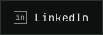
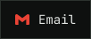
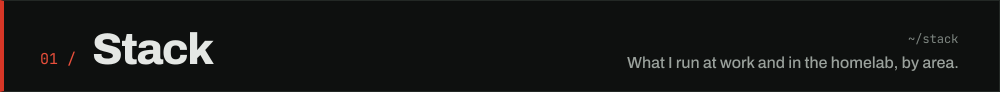
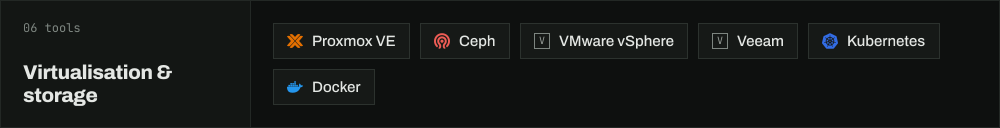
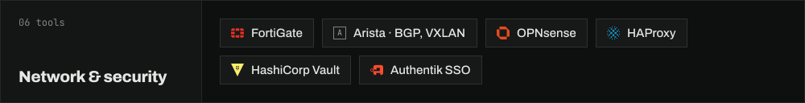
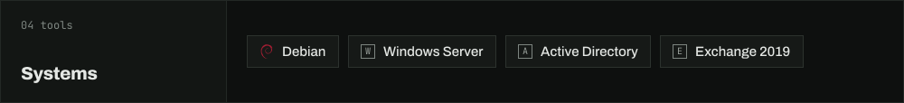
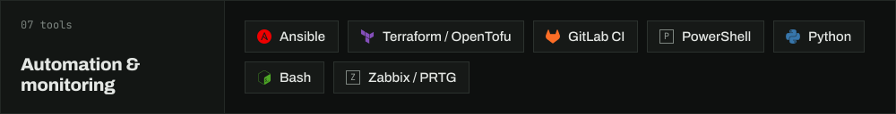
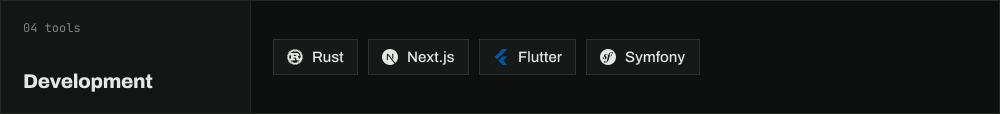
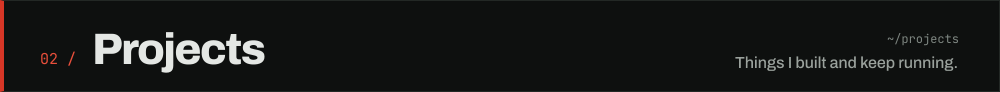
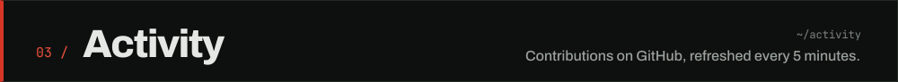

  
  
  
  

- **At work** – L2/L3 support for a hosting and managed services provider: about 500 VMs across two data centres (Proxmox VE with stretched Ceph, VMware, Veeam).
  - Set up Infrastructure as Code (GitLab CI, Vault, Ansible, Terraform): a VM now deploys in minutes instead of hours.
  - Designing a multi-tenant disaster recovery portal on Veeam.
- **At school** – 5th year at EPSI Nantes, master's-level degree (RNCP level 7) due in 2027, after a bachelor's in systems, network and database administration (2025).
- **At home** – a homelab running 24/7: 3-node Proxmox VE cluster with Ceph on 10 GbE, Kubernetes, GitLab, Vault, Authentik SSO and OPNsense. It also hosts my website.
- **On the blog** – what I build, written up step by step: [albanmary.com/blog](https://albanmary.com/blog/?utm_source=github)

| | |
|---|---|
| **[albanmary.com](https://albanmary.com/?utm_source=github)** | My portfolio and blog. Next.js in Docker, self-hosted, deployed with Watchtower; strict CSP, Lighthouse 100 on desktop, cookieless analytics. |
| **Homelab** | Self-hosted platform running 24/7: Proxmox VE + Ceph cluster, Kubernetes, GitLab and registry, Vault, Authentik, NetBox, Graylog, NetBird mesh VPN. |
| **[MonitorFlow](https://github.com/Kidoly/monitorflow)** | Real-time server monitoring with alerts: Rust agent, API, Flutter and Next.js clients. |
| **[Proxmox articles](https://albanmary.com/proxmox/?utm_source=github)** | Debian 13 Cloud-Init templates driven by Terraform, Docker updates with Watchtower, site-to-site IPsec. |

